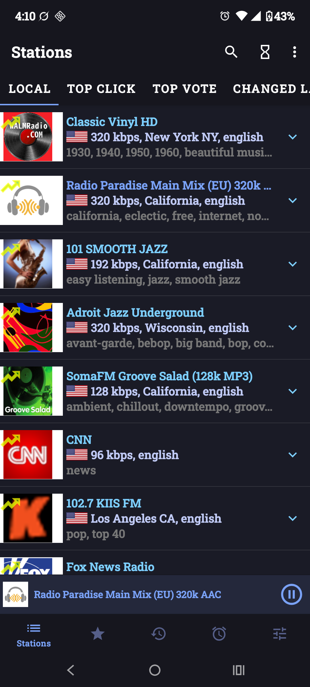
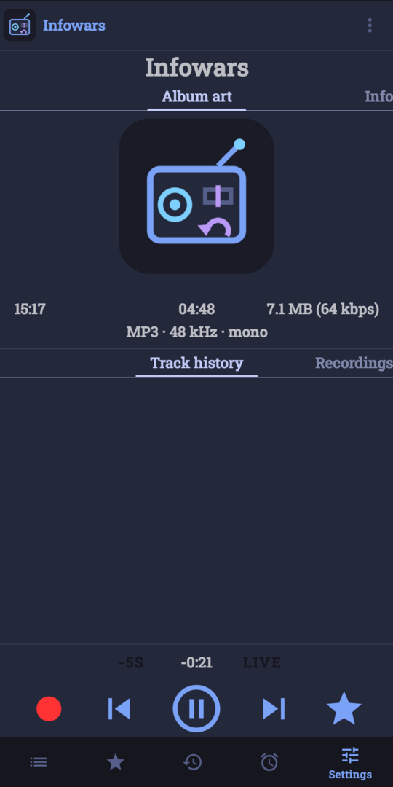
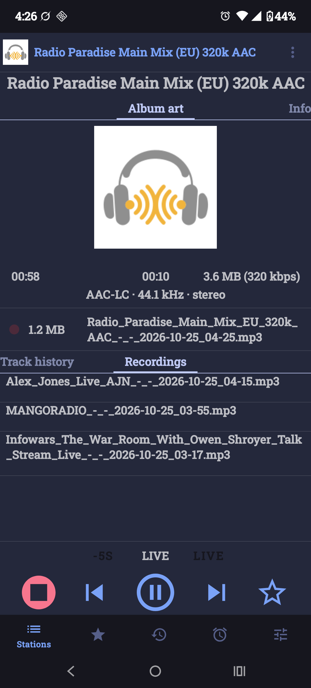
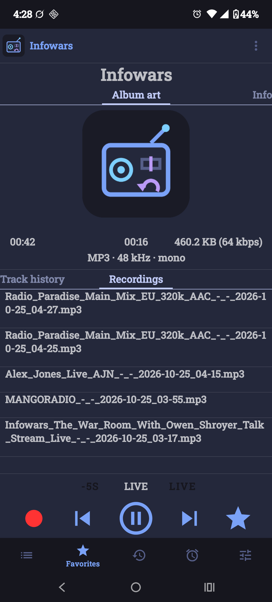

# Radio Arkiv — a fork of RadioDroid

**Radio Arkiv** (formerly "Radio") is an unofficial fork of [RadioDroid](https://github.com/segler-alex/RadioDroid)
by segler-alex and contributors, an Android internet-radio app built on the free
[Radio Browser](https://www.radio-browser.info) station directory.
Current version: **1.0.1** (based on RadioDroid 0.86).
It installs alongside upstream (`applicationId io.github.arkivx0.radio`).
All credit for the app itself goes to the RadioDroid project. Licensed GPL-3.0 like upstream.

<p align="center">
  
  
  
  
</p>
<p align="center"><em>Stations shown are a random selection picked from the public directory for screenshots and testing, not an endorsement.</em></p>

## What this fork adds
- **Incoming-call crash fix**: audio-focus loss (e.g. a call) no longer kills the service on Android 12+;
  playback pauses cleanly and resumes after the call.
- **11 skins** with swatch previews in Settings → theme: Omarchy / Tokyo Night (default), AMOLED Black,
  Gruvbox Dark, Catppuccin Mocha, Nord, Dracula, Enclave, Terminal (green phosphor), Vintage (tube radio),
  Light and Dark. Bundled OFL fonts: VT323 and Limelight.
- **Time-shift**: skip back 5 s (repeatable, up to ~5 min) and **Go live**, with a behind-live indicator.
- **Lock-screen / media controls**: media notification with Back 5 s, Go live and Record actions.
- **Scheduled recordings**: pick station, start time, duration, once or on repeat days.
- **Silent recordings**: scheduled recordings can record without playing aloud or taking audio focus
  (per-schedule *Record silently* option, on by default; off keeps play-while-recording). There is also
  *Record now silently*. Files go to `Music/Radio` like other recordings. All recording options are in
  Settings → Recordings.
- **Open audio files with Radio Arkiv**: recordings (`Music/Radio`) and other audio files can be opened with Radio Arkiv
  and play in its player with seeking, pause/resume and lock-screen controls. In the recordings list, tap to
  play in Radio Arkiv, long-press to open with another app.
- **Open file**: the folder button in the toolbar (or ⋮ → *Open audio file…*, or the top row of the Recordings tab) picks any audio file with the system file picker (no storage
  permission needed) and plays it in Radio Arkiv.
- **Codec info line**: the full player shows the decoded source format, e.g. `AAC-LC · 44.1 kHz · stereo`.
- **Android 13/14 fixes**: recording without legacy storage permission, exact-alarm fallback,
  notification-permission prompt, unique provider authorities, working sleep timer and alarms.
- **Fixes for upstream issues**:
  [#1260](https://github.com/segler-alex/RadioDroid/issues/1260) Wi-Fi playback blocked when mobile data is on,
  [#1261](https://github.com/segler-alex/RadioDroid/issues/1261) favourite star not updating,
  [#1241](https://github.com/segler-alex/RadioDroid/issues/1241) crash searching short names like "rad",
  [#1222](https://github.com/segler-alex/RadioDroid/issues/1222) silent failure adding an alarm,
  [#349](https://github.com/segler-alex/RadioDroid/issues/349) stream format details.
- **About screen** works again and shows this fork's info.

## Install
Download `RadioArkiv.apk` from the [Releases](../../releases) page and sideload it (allow "install unknown apps").
It does not replace RadioDroid. Builds are the `free` flavor (no proprietary services, no analytics).

## Download & verify
Download `RadioArkiv.apk` from [Releases](../../releases). APKs are signed with the Radio Arkiv release key.

- Signing certificate SHA-256:
  `291e1bccf7a19a6d0542a0a4c1af02aef42d305216534d798a85dc4187254861`
- APK SHA-256 for 1.0.1:
  `cdcbcbd0d8d7c50eaa0f5ad8b15f7915f72dcb429a4ba3357be0d32af56de521`

Verify before installing:
```
sha256sum RadioArkiv.apk
apksigner verify --print-certs RadioArkiv.apk   # "Signer #1 certificate SHA-256 digest" must match
```
Each release lists its own APK SHA-256; the certificate fingerprint stays the same for all updates.

## Known limits
- HLS streams cannot be rewound (time-shift works for regular Icecast/Shoutcast streams).
- Silent recording does not support HLS streams (turn *Record silently* off for those).
- Time-shift positions are estimated from the stream bitrate; jumps can cause a short gap.

## Credits and license
Based on [RadioDroid](https://github.com/segler-alex/RadioDroid) by segler-alex and contributors.
Station data from [Radio Browser](https://www.radio-browser.info).
Free software under the [GNU General Public License v3.0](https://www.gnu.org/licenses/gpl-3.0.html).
